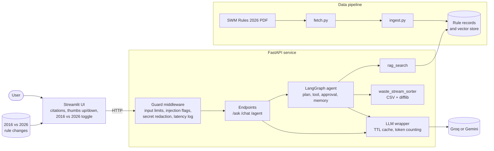

# ♻️ KachraCheck

**Ask a question about India's Solid Waste Management Rules 2026 and get a plain-language answer with the rule behind it.**
KachraCheck turns a 144-page legal gazette into an assistant that tells households, housing societies and local bodies what they must actually do, and shows what changed since the 2016 rules.

[▶ Watch the 2-minute demo](https://YOUR-VIDEO-LINK)


## The problem

From 1 April 2026 the SWM Rules 2026 replace the 2016 rules. Waste must now be sorted into **four streams** (wet, dry, sanitary and special care) instead of three, bulk generators face new responsibilities, and penalties are tougher. Almost nobody reads a 144-page PDF, so people either guess or follow outdated advice. Search engines return news summaries, not the clause that applies to you.

## What KachraCheck does

- **Answers with citations.** Every answer shows the rule records it was built from, so you can check it instead of trusting it.
- **Sorts household items.** "Where does an old CFL bulb go?" is answered from a hand-built item list with fuzzy spelling matching ("bannana peel" still works).
- **Flips between 2016 and 2026.** Any answer can be shown next to the old rule, with the changed words highlighted.
- **Uses tools, memory and approval.** An agent decides when to search the rules or sort an item, remembers the conversation, and can pause for a human to approve its draft.
- **Says when it does not know.** Low-confidence answers are labelled, and the model may only use the retrieved records.

## How it works



## Results

**Data pipeline** (real run on the 2026 gazette PDF)

| Step | Result |
|---|---|
| Pages read from the PDF | 144 (66 in English) |
| Rules found / duty rules | 44 / 27 |
| Clause rows extracted | 222 |
| Hand-curated records used by the API | 20 (all 20 found again in the PDF) |
| Test questions answerable from the records | 10 of 10 |

**Production measurements** (generated by `python -m scripts.benchmark --write`)

<!-- BENCH:START -->
_Not measured yet. Start the API, then run `python -m scripts.benchmark --write` to fill this table with real numbers._
<!-- BENCH:END -->

## Production notes

| Concern | What KachraCheck does |
|---|---|
| **Latency and tokens** | Every request is logged to `logs/requests.jsonl` with latency, LLM calls, prompt/completion tokens and whether the cache answered. `GET /metrics` shows p50/p95 latency, average tokens and the cache hit rate. |
| **Cache** | LLM responses are cached in memory for 10 minutes (up to 256 entries, oldest dropped first). A repeated question costs zero tokens and returns in milliseconds. Settings: `KC_CACHE_TTL_SECONDS`, `KC_CACHE_MAX_ENTRIES`. |
| **Input limits** | Request bodies over 8 KB get `413`; questions over 500 characters get `422`, before any model call. Settings: `KC_MAX_BODY_BYTES`, `KC_MAX_QUESTION_CHARS`. |
| **Prompt injection** | Three layers: the system prompt treats the question and records as data, never as instructions; the middleware flags known attack phrases (set `KC_BLOCK_INJECTION=1` to reject them with `400`); and any API key that appears in a response is replaced with `[redacted]`. A test simulates a model that obeys the attack and leaks a key. |
| **Secrets** | Keys live in `.env`, which is never committed. Docker gets them from the environment at start-up, not from the image. |

**Known limits.** The cache lives in one process and resets on restart. Attack-phrase detection is a heuristic, so it reduces risk and does not remove it. There is no login or rate limiting yet, so do not expose the API to the open internet as it is.

## Run it

```bash
python -m venv .venv
.venv\Scripts\activate            # Windows (use source .venv/bin/activate on Mac/Linux)
pip install -r requirements.txt
copy .env.example .env            # then add your Groq or Gemini key
uvicorn app.main:app --reload     # API  -> http://127.0.0.1:8000/docs
streamlit run ui/app.py           # UI   -> http://localhost:8501
```

### Run with Docker

```bash
copy .env.example .env            # add your key
docker compose up --build
```
API docs at http://localhost:8000/docs, chat UI at http://localhost:8501. Stop with `Ctrl+C` and `docker compose down`.

### Tests and lint

```bash
pip install -r requirements-dev.txt
pytest
ruff check .
```

## Project layout

```
app/        FastAPI service, retrieval, LLM wrapper, agent (loop + LangGraph), production guards
ui/         Streamlit chat with citations, feedback and the 2016 vs 2026 toggle
data/       rule records, waste item list, 2016 vs 2026 changes, raw PDFs
prompts/    system and task prompts
eval/       prompt comparison (v1 vs v2) on 10 questions
scripts/    benchmark that writes the numbers above
tests/      pytest suite
docs/       data pipeline notes, checkpoints, resume bullets
```

## Honest limitations

- Guidance only, not legal advice. Always check the official gazette for your case.
- The 2016 vs 2026 comparison is a short, hand-written summary per topic, not a clause-by-clause diff.
- Answers depend on the 20 curated records, so questions outside them get a low-confidence reply.
