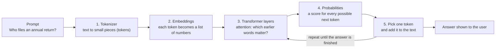

# How a Large Language Model works

*Written for my KachraCheck project, Gen AI Exammate 2026-27.*

An LLM is a program that has read a huge amount of text and learned one skill: **given the text so far,
guess the next small piece of text.** Everything it does, from answering questions to writing code,
comes from repeating that one guess many times.

## The diagram

## What happens at each step

1. **Tokenizer.** The model cannot read letters directly. The text is cut into tokens, which are pieces
   like a whole word, part of a word, or a symbol. "Annual return" is a couple of tokens; a rare word like
   "bio-methanation" is split into several.
2. **Embeddings.** Each token is turned into a long list of numbers. Words used in similar ways end up with
   similar numbers, so "municipality" and "urban local body" sit close together even though the letters differ.
3. **Transformer layers and attention.** This is the main part. For every token, *attention* lets the model
   look back at the other tokens and decide which ones matter most. In "The operator must file *it* by 30
   June", attention helps decide that *it* means the return and not the operator.
4. **Probabilities.** At the end the model gives every possible next token a probability, for example
   "June" 70% and "March" 5%.
5. **Pick and repeat.** One token is chosen (usually a likely one, with a little randomness), added to the text,
   and the whole process runs again for the next token. A full answer is built one token at a time.

## How it learns

- **Pre-training.** The model reads a very large amount of text and keeps guessing the next token. Each wrong guess
  nudges its numbers (called weights) a little. After billions of guesses it has absorbed grammar, facts and patterns.
- **Post-training.** A second stage teaches it to behave like an assistant: follow instructions, answer
  politely, refuse unsafe requests. People rate answers, and the model is adjusted toward the better ones.

## What it cannot do (and why it matters for me)

- **It does not look things up.** It only has what it learned during training, so it can be out of date.
  The SWM Rules 2026 are new, so a model may never have seen them.
- **It can sound sure and still be wrong.** It produces *likely* text, not *checked* text. This is called
  hallucination. For a rules checker, a made-up deadline or clause number is a serious fault.
- **It has a limited context window.** It can only pay attention to a fixed amount of text at once.

## How this connects to KachraCheck

| | LLM | KachraCheck today |
|---|---|---|
| Where answers come from | Patterns learned in training | 20 records I wrote from the gazette PDF |
| How it finds them | Meaning, through embeddings and attention | TF-IDF: counts words, ranks by cosine similarity |
| Can it be wrong confidently? | Yes (hallucination) | Yes, but each answer points to a real clause and source URL |
| Knows what it does not know? | Not reliably | Partly: it flags a question as unanswerable when most of its words are missing from the data |

I chose search over a data set first because a duty checker must give the *real* clause, not a fluent guess.
A sensible next step is to combine both: use my search to fetch the right clause, then let an LLM explain
it in plain language, while still showing the rule number and source (this pattern is called
retrieval-augmented generation). My TF-IDF only matches words, so it misses meaning. An embedding model
would fix that, and I saw this when my first version could not connect "municipalities" to "urban local bodies"
until I added a synonym list by hand.
